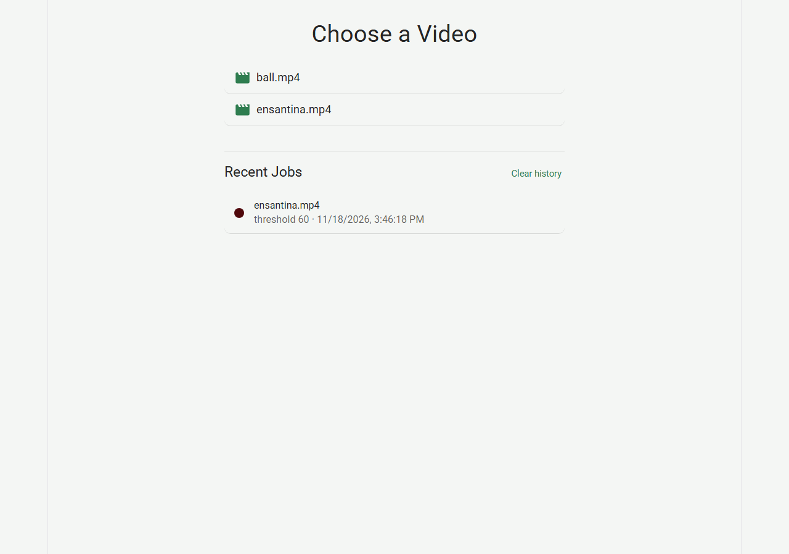
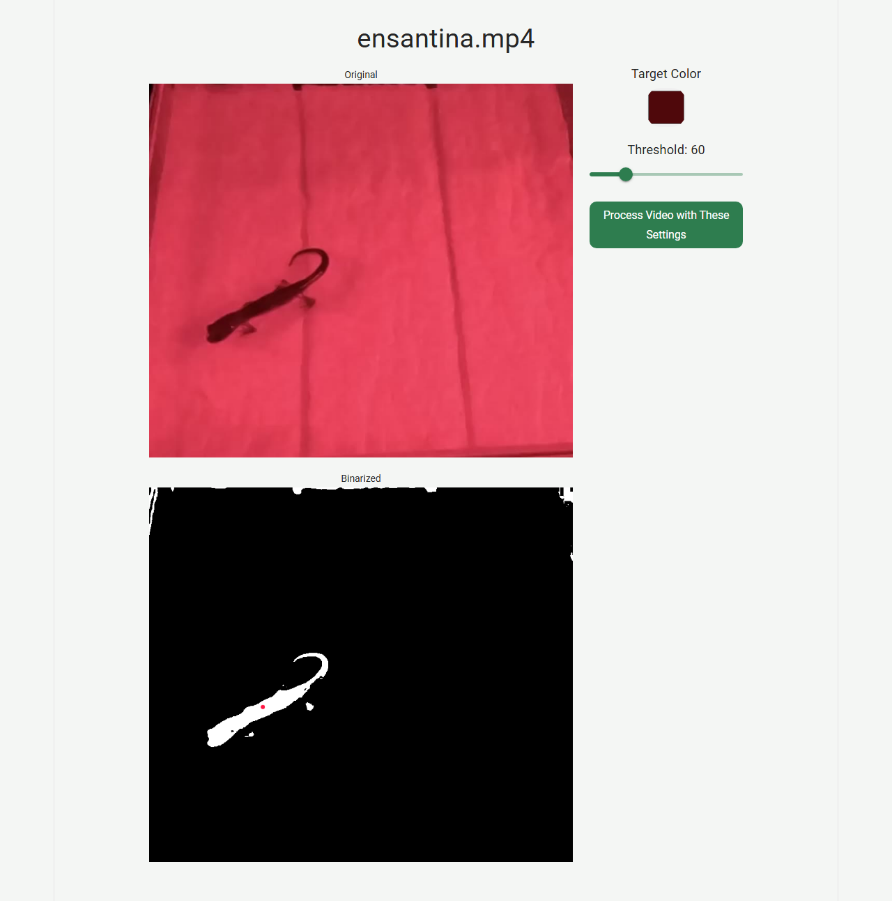
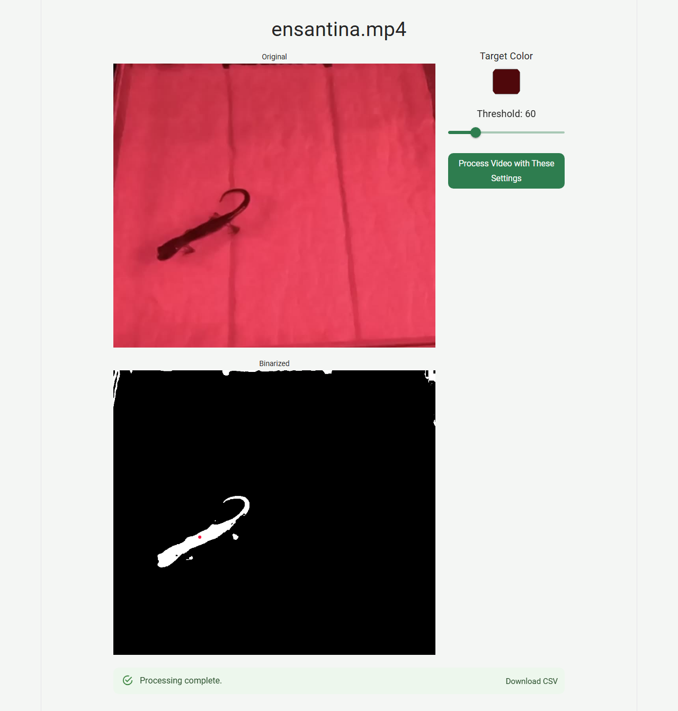
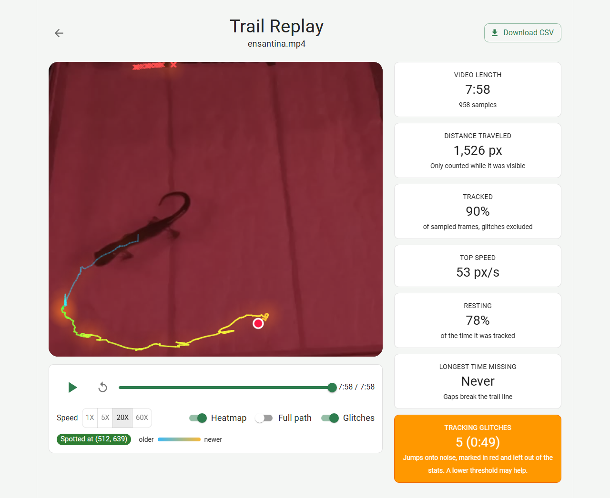

# centroid-finder-frontend

React frontend for the [centroid-finder](https://github.com/onjamm/centroid-finder) salamander-tracking backend. Lets a user pick a video, live-tune a target color/threshold against a binarized preview with a centroid dot, submit it for processing, and track the resulting job.

See [TASKS.md](TASKS.md) for the project plan, file ownership between contributors, and the frozen contracts both halves of the app build against.

## Setup

### 1. Backend

The frontend talks to the backend ([centroid-finder/server](https://github.com/onjamm/centroid-finder/tree/server/server)) on `localhost:3000`. It needs Node, Java 21+, Maven and [ffmpeg](https://ffmpeg.org/) on your `PATH` (ffmpeg generates thumbnails; on Windows, `winget install Gyan.FFmpeg`).

```bash
# in the centroid-finder repo
cp .env.example .env          # points VIDEOS_DIR at processor/sampleInput

# build the Java video processor (produces processor/target/videoprocessor.jar)
cd processor
mvn -DskipTests package
cd ..

# start the API server
cd server
npm install
node index.js                 # "Server running on port 3000"
```

Videos are served from `processor/sampleInput/`. `ball.mp4` is included. To try real footage, drop the sample salamander video from the assignment (`ensantina.mp4`) into that folder. It's git-ignored, so it won't be committed.

### 2. Frontend

```bash
npm install
npm run dev
```

The app runs at http://localhost:5180 and reaches the backend through a Vite dev proxy (see `vite.config.js`). If the backend isn't running, the Video Chooser falls back to the mock data in `src/mock/`.

## Scripts

- `npm run dev` - start the Vite dev server
- `npm run build` - production build
- `npm test` - run unit tests (Mocha + Chai) against `src/lib/centroid/*`
- `npm run test:e2e` - run end-to-end tests (Playwright) against the running app

## Project structure

```
src/
  api/          fetch wrappers for the backend's 4 endpoints
  lib/centroid/ pure-JS reimplementation of the Java image-processing pipeline
  mock/         placeholder data standing in for the backend
  components/   reusable UI pieces, including the required HOC (hoc/withLoading.jsx)
  pages/        route-level pages (VideoChooser, VideoPreview)
tests/
  unit/         Mocha + Chai tests for src/lib/centroid
  e2e/          Playwright tests for the running app
```

## Screenshots

All screenshots were captured against the live backend running the sample salamander video (`ensantina.mp4`), with target color `#4F080B` and threshold `60`.

**Video Chooser** (`/videos`): lists videos from `GET /api/videos`. Below them is the Recent Jobs history, our unique feature, which is saved in `localStorage`.



**Video Preview** (`/preview/:filename`): the first frame comes from `GET /thumbnail/:filename`. Next to it is a binarized version that updates live as the color picker and threshold slider change, with a red dot at the centroid of the largest connected group (computed in `src/lib/centroid`, a JavaScript port of the Java pipeline).



**Processing**: "Process Video with These Settings" sends `POST /process/:filename?targetColor=&threshold=`, then polls `GET /process/:jobId/status` every 2 seconds while the Java processor runs.


**Job complete**: once the job finishes, a link to the resulting CSV appears (one `time,x,y` row per sampled frame, `-1,-1` when no salamander is found).



**Trail Replay** (`/replay/:filename/:jobId`): "Watch trail replay" (on a finished job, or the timeline icon in Recent Jobs) turns the CSV into an animated path over the video frame. You get a play/pause timeline you can scrub, a heatmap of where the salamander spent its time, and movement stats. The replay also detects **tracking glitches**: frames where the tracker jumped onto noise and then jumped back. They're marked with red crosses and left out of the distance and speed stats, so you know when to lower the threshold. The logic lives in `src/lib/trail.js` and is unit-tested.


