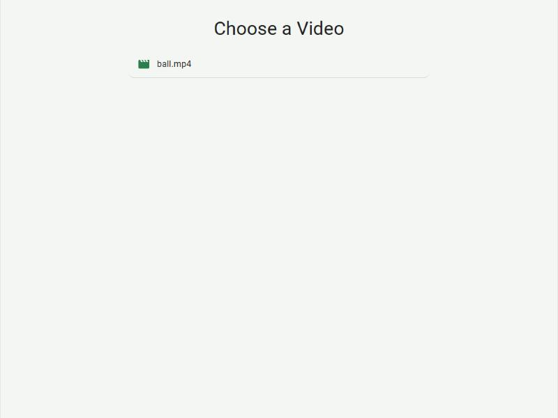
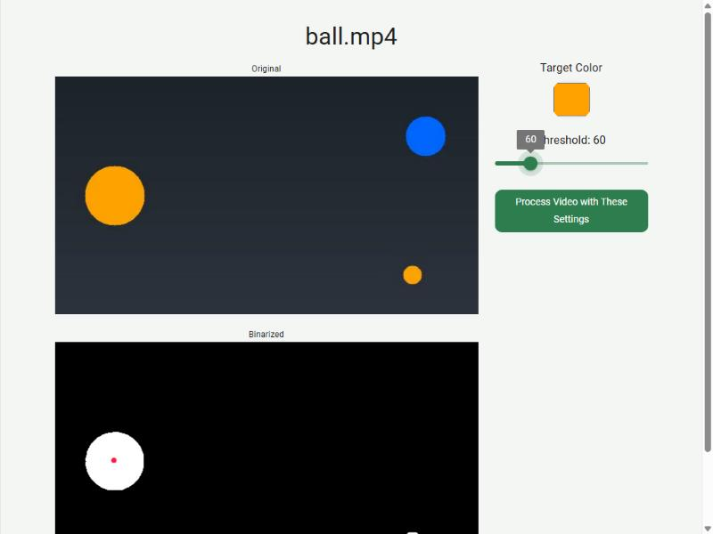
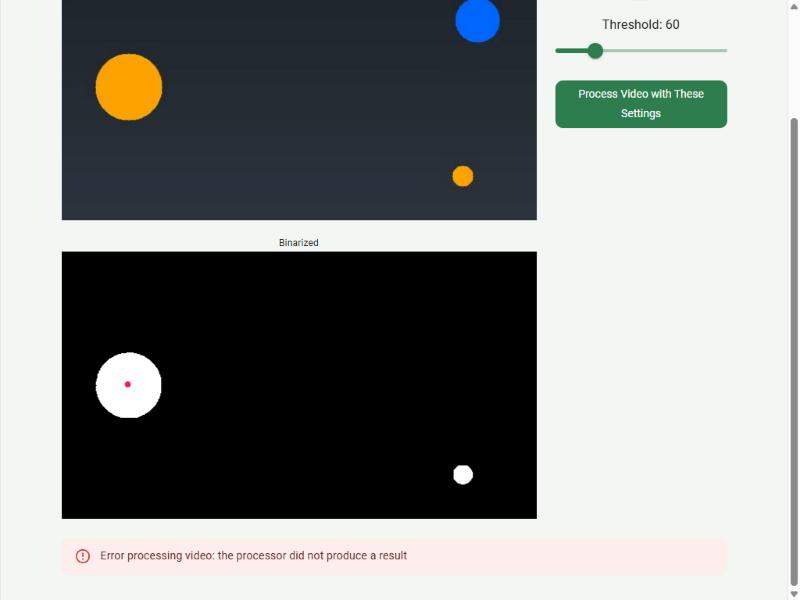

# centroid-finder-frontend

React frontend for the [centroid-finder](https://github.com/onjamm/centroid-finder) salamander-tracking backend. Lets a user pick a video, live-tune a target color/threshold against a binarized preview with a centroid dot, submit it for processing, and track the resulting job.

See [TASKS.md](TASKS.md) for the project plan, file ownership between contributors, and the frozen contracts both halves of the app build against.

## Setup

```bash
npm install
npm run dev
```

The app runs at http://localhost:5180. It talks to the backend ([centroid-finder/server](https://github.com/onjamm/centroid-finder/tree/server/server)) via a Vite dev proxy (see `vite.config.js`) — start the backend separately on `localhost:3000`:

```bash
# in the centroid-finder repo, server/ directory
npm install
npm start
```

Without the backend running, pages should fall back to the mock data in `src/mock/`.

## Scripts

- `npm run dev` - start the Vite dev server
- `npm run build` - production build
- `npm test` - run unit tests (Mocha + Chai) against `src/lib/centroid/*`
- `npm run test:e2e` - run end-to-end tests (Playwright) against the running app

## Project structure

```
src/
  api/          fetch wrappers for the backend's 4 endpoints
  lib/centroid/ pure-JS reimplementation of the Java image-processing pipeline
  mock/         placeholder data standing in for the backend
  components/   reusable UI pieces, including the required HOC (hoc/withLoading.jsx)
  pages/        route-level pages (VideoChooser, VideoPreview)
tests/
  unit/         Mocha + Chai tests for src/lib/centroid
  e2e/          Playwright tests for the running app
```

## Screenshots

Captured against a live backend (Express server on `localhost:3000`, with `ffmpeg` on `PATH` for thumbnails) and the Vite dev server on `localhost:5180`.

**Video Chooser** — lists videos fetched from the backend's `GET /api/videos`:



**Video Preview** — live binarized preview (client-side `lib/centroid`) over a thumbnail generated by the backend's `GET /thumbnail/:filename` (ffmpeg), with target color/threshold controls:



**Processing** — `POST /process/:filename` submits a job and the UI polls `GET /process/:jobId/status`. The error below is a genuine backend response: `processor/target/videoprocessor.jar` isn't built in this environment (no Maven), so the Java processor can't run — the UI's error handling is otherwise exercised end-to-end:


